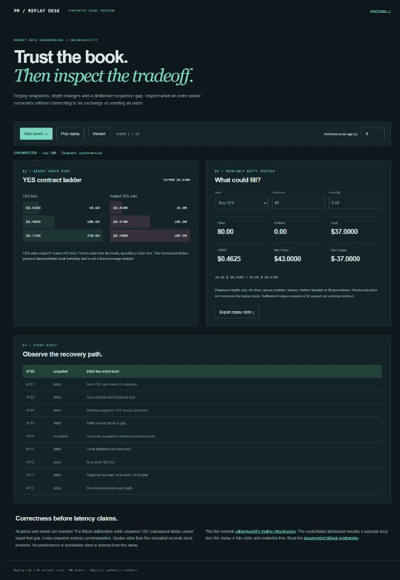

# Prediction Market Trading Desk · Replay Lab

This fork extends [williamhao99/pm-tradingdesk](https://github.com/williamhao99/pm-tradingdesk), preserving the upstream Kalshi dashboard, hotkey tools and Polymarket monitors. Fork work adds a reproducible offline order-book lab, local dashboard boundaries and regression coverage. Upstream latency and personal-production claims are not measurements of this fork.



## Start with the credential-free replay

```bash
python -m http.server 49216
```

Open http://localhost:49216/replay/. Step or play ten explicitly synthetic events, observe a missing sequence, recover with a snapshot, switch YES/NO, change quantity/limit, simulate quote age, and export the analyzed state. No exchange connection, account, wallet, notification or order is created.

The normalized fixture protocol is intentionally separate from a live exchange adapter. Bids and complementary asks retain four-decimal dollar prices and two-decimal contract quantities, consistent with the [documented binary order-book relationship](https://docs.kalshi.com/getting_started/orderbook_responses). The replay rejects stale, unsynchronized, negative-depth and crossed-book previews; duplicates do not double depth. The read-only preview walks visible depth up to a limit, reports partial fills, VWAP, cost and both conditional settlement outcomes. It excludes fees, queue position, latency and hidden liquidity and never guarantees a fill.

## Tests

```bash
npm test
python -m venv .venv
# Windows: .venv\Scripts\python; Unix: .venv/bin/python
.venv/bin/python -m pip install -r requirements-test.txt
.venv/bin/python -m unittest discover -s tests -p "test_*.py"
```

Ten Node tests cover the book engine and six Python tests exercise the actual FastAPI WebSocket handler with a mocked client: missing/foreign origins, hostname rebinding, empty fills, disabled execution, explicit opt-in policy and disconnect-during-broadcast. No live credentials are used. The browser has no dependency build step or external CDN.

## Existing credentialed local dashboard

The original application remains available, but is a separate workflow from the replay:

```bash
python -m venv venv
# Activate venv for your shell, then:
pip install -r requirements.txt
# Copy .env.example to .env and configure your own credentials/key file.
python -m src.kalshi.dashboard.web_server
```

The server binds to `127.0.0.1:8000`, accepts only local Host values and the exact local browser origins on port 8000, and starts with order, cancel, hotkey-start, hotkey-execution and configuration-generation actions disabled. Stopping a running bot remains available. `DASHBOARD_ENABLE_EXECUTION=true` is an explicit opt-in for an intentionally configured local session; it is not set by the replay. `.env.example` selects the provider's demo environment. This dashboard gate does not govern the separately launched upstream CLI bots. Keep credentials ignored, and do not expose this unauthenticated local dashboard publicly; origin checks are not user authentication.

The update also fixes an uninitialized empty-fills response, snapshots the connection set before broadcasting, makes uvloop optional on Windows, and removes an unused SDK import from the dashboard's hotkey-generation dependency. Existing exchange API integrations and live execution were not end-to-end tested; current provider schema migration may still be required. No live latency or profitability figure is claimed.

## Upstream tools

The original launchers remain in `scripts/`; Polymarket monitoring code remains under `src/polymarket/`. They require separately configured credentials and may send notifications or trade when explicitly launched. Review their configuration before using them. Original authorship belongs to the upstream project; the additions above are this fork's contribution. No new license is asserted for upstream code where none was supplied.
